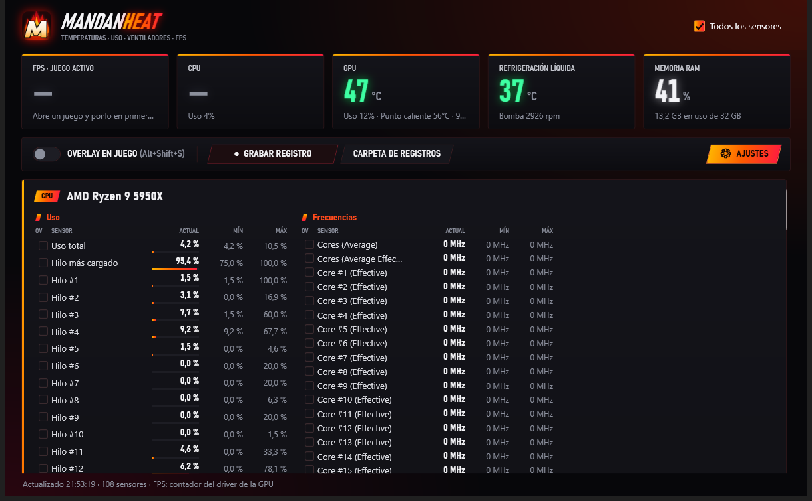
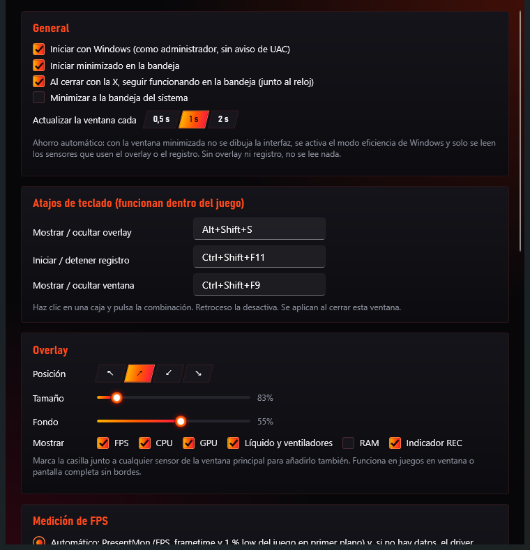

<p align="center">
  
</p>

<h1 align="center">MandanHeat</h1>

<p align="center">
  Monitor de hardware gratuito para Windows: temperaturas, uso, ventiladores, potencia y <b>FPS del juego</b>,
  con <b>overlay</b> dentro del juego y <b>registro de métricas</b> en CSV.
</p>

<p align="center">
  <a href="../../releases/latest"><b>⬇ Descargar la última versión</b></a>
</p>



## Características

- **Sensores de todo el equipo**:
  - **CPU**: temperatura (Tctl/Tdie y CCDs), uso por hilo y potencia.
  - **GPU**: borde, punto caliente y memoria; uso, potencia y ventilador.
  - **Refrigeración líquida** (NZXT Kraken, Corsair…): líquido y bomba.
  - **Placa base**: MOS, chipset y ventiladores de cada conector.
  - **RAM** y **discos**.
- **FPS del juego en primer plano**, con frametime y 1 % low (mediante [PresentMon](https://github.com/GameTechDev/PresentMon)).
  Si no está disponible, usa el contador del driver de la GPU.
- **Overlay en juego**, transparente y que no captura clics. Puedes elegir la esquina, el tamaño, la opacidad y qué mostrar.
  Cualquier sensor se puede añadir al overlay.
- **Registro de métricas** a CSV (formato parecido al de HWiNFO), con un **resumen** al terminar:
  mínimo, media y máximo de cada sensor, y FPS medios, 1 % low y 0,1 % low.
  Se puede iniciar solo al abrir un juego y parar al cerrarlo.
- **Atajos de teclado globales** configurables, que funcionan dentro del juego.
- **Bandeja del sistema**: al cerrar la ventana sigue funcionando junto al reloj. Opción de iniciar con Windows.
- **Bajo consumo**: con la ventana oculta no dibuja la interfaz, activa el modo eficiencia de Windows 11
  y solo lee los sensores que necesitan el overlay o el registro.
- Sensores **renombrables y ocultables** (clic derecho sobre cualquiera).

| Overlay | Ajustes |
|---|---|
|  |  |

## Instalación

1. Descarga `MandanHeat-win-x64.zip` desde **[Releases](../../releases/latest)** y descomprímelo donde quieras.
   Es un único `MandanHeat.exe`: no hace falta instalar nada más, ni siquiera .NET.
2. **Instala el driver PawnIO**. Es necesario para leer la temperatura de la CPU y los sensores de la placa base. Abre PowerShell y ejecuta:
   ```powershell
   winget install namazso.PawnIO
   ```
   O descárgalo de <https://pawnio.eu/>. Es el driver firmado que usa LibreHardwareMonitor.
3. Abre `MandanHeat.exe`. Pedirá **permisos de administrador**: los necesita para leer los sensores y medir los FPS.
4. *(Opcional)* Para FPS, frametime y 1 % low de cualquier juego, pulsa **«Descargar PresentMon»** en el aviso de la app.

> **Aviso de Windows SmartScreen:** al no estar firmado digitalmente, Windows puede mostrar
> «Windows protegió su PC». Pulsa **Más información → Ejecutar de todas formas**.

## Uso

| Acción | Cómo |
|---|---|
| Mostrar u ocultar el overlay | Interruptor «Overlay en juego» o **Ctrl+Shift+F10** |
| Iniciar o detener un registro | Botón «Grabar registro» o **Ctrl+Shift+F11** |
| Mostrar u ocultar la ventana | **Ctrl+Shift+F9**, o doble clic en el icono de la bandeja |
| Salir del todo | Clic derecho en el icono de la bandeja → **Salir** |
| Renombrar, ocultar o fijar un sensor en el overlay | Clic derecho sobre el sensor |

Todos los atajos, el overlay, la fuente de FPS, la carpeta de registros y demás opciones se cambian en **⚙ Ajustes**.

- El overlay funciona en juegos **en ventana o en pantalla completa sin bordes**. En pantalla completa *exclusiva*, Windows no deja pintar encima.
- Los registros se guardan como `Juego_fecha_hora.csv` (columnas `Date`, `Time` y `Sensor [unidad]`) junto a un `…_resumen.txt`.
- Los ajustes se guardan en `%AppData%\MandanHeat\settings.json`.

## Solución de problemas

- **No aparecen la temperatura de la CPU ni los sensores de la placa**: comprueba que PawnIO está instalado
  y que la app se ejecuta como administrador.
- **No aparecen los ventiladores de la placa**: otro programa de monitorización (NZXT CAM, MSI Center, iCUE…)
  puede tener ocupado el chip. Ciérralo y pulsa «Reintentar» en el aviso.
- **Ajustes → Exportar informe de sensores** genera un archivo con todos los sensores detectados.
  Adjúntalo si abres una *issue*.

## Compilar desde el código

Requiere el [SDK de .NET 10](https://dotnet.microsoft.com/download).

```powershell
# Ejecutar en desarrollo
dotnet run --project src\MandanHeat

# Generar el ejecutable único (release\MandanHeat.exe y el .zip)
powershell -ExecutionPolicy Bypass -File .\publicar.ps1

# Publicar una versión nueva: GitHub Actions compila y crea la Release solo
powershell -ExecutionPolicy Bypass -File .
ueva-version.ps1 -Version 1.2.0
```

Tecnología: C# / WPF (.NET 10), [LibreHardwareMonitorLib](https://github.com/LibreHardwareMonitor/LibreHardwareMonitor)
para los sensores y [PresentMon](https://github.com/GameTechDev/PresentMon) para los FPS. PresentMon usa ETW: no inyecta nada en el juego y es seguro con los sistemas antitrampas.

## Licencia

[MIT](LICENSE). Las licencias de los componentes de terceros están en [THIRD-PARTY-NOTICES.md](THIRD-PARTY-NOTICES.md).
