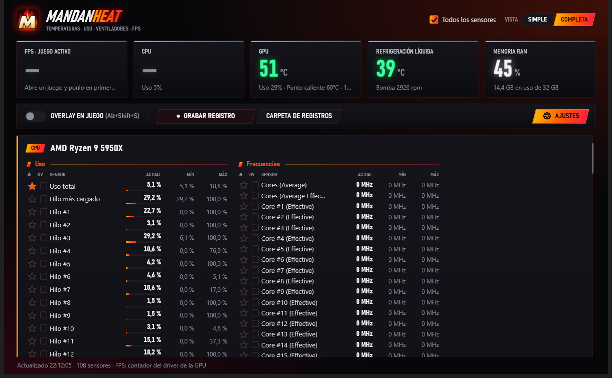
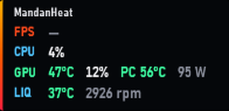

<p align="center">
  
</p>

<h1 align="center">MandanHeat</h1>

<p align="center">
  <b>Free hardware monitor for Windows</b>: CPU &amp; GPU temperatures, usage, fan speeds, power draw and <b>in-game FPS</b>,
  with an <b>in-game overlay</b> and <b>CSV metrics logging</b>.
</p>

<p align="center">
  <a href="../../releases/latest"></a>
  <a href="../../releases"></a>
  
  <a href="LICENSE"></a>
  <a href="../../stargazers"></a>
</p>

<p align="center">
  <a href="../../releases/latest"><b>⬇ Download the latest version</b></a>
</p>


MandanHeat is a lightweight, open-source alternative to MSI Afterburner / RTSS, HWiNFO and HWMonitor for people who want
one small app to **monitor PC temperatures, check game FPS and frametime, show an overlay while gaming, and log everything
to a file** for benchmarking or troubleshooting. Single portable `.exe`, no installer, no .NET runtime needed.

## Features

- **Simple view** with the basic metrics (or the ones you pick with ★) and **full view** with every sensor of each component.

- **Sensors for your whole system**:
  - **CPU**: temperature (Tctl/Tdie and per-CCD), per-thread usage and power.
  - **GPU**: edge, hot spot and memory temperatures; usage, power and fan speed.
  - **Liquid cooling** (NZXT Kraken, Corsair…): coolant temperature and pump speed.
  - **Motherboard**: VRM (MOS), chipset and every fan header.
  - **RAM** and **drives**.
- **In-game FPS** of the foreground game, with frametime and 1 % low (via [PresentMon](https://github.com/GameTechDev/PresentMon)).
  Falls back to the GPU driver counter when PresentMon is unavailable.
- **In-game overlay**: transparent and click-through. Choose the corner, size, opacity and what to show.
  Any sensor can be added to the overlay.
- **Metrics logging** to CSV (similar to HWiNFO's format), with a **summary** when you stop:
  min, average and max of every sensor, plus average FPS, 1 % low and 0.1 % low.
  It can start automatically when a game opens and stop when it closes.
- **Global hotkeys**, configurable, that work inside games.
- **System tray**: closing the window keeps it running next to the clock. Optional start with Windows.
- **Low overhead**: with the window hidden it stops drawing the UI, enables Windows 11 efficiency mode
  and only reads the sensors the overlay or the log actually need.
- Sensors can be **renamed and hidden** (right-click any of them).



| Overlay | Settings |
|---|---|
|  |  |

## Installation

1. Download `MandanHeat-win-x64.zip` from **[Releases](../../releases/latest)** and unzip it anywhere.
   It is a single `MandanHeat.exe`: nothing else to install, not even .NET.
2. **Install the PawnIO driver.** It is required to read the CPU temperature and the motherboard sensors. Open PowerShell and run:
   ```powershell
   winget install namazso.PawnIO
   ```
   Or download it from <https://pawnio.eu/>. It is the signed driver used by LibreHardwareMonitor.
3. Run `MandanHeat.exe`. It asks for **administrator rights**, which it needs to read the sensors and measure FPS.
4. *(Optional)* For FPS, frametime and 1 % low in any game, click **"Download PresentMon"** in the app's notice.

> **Windows SmartScreen warning:** since the app is not digitally signed, Windows may show
> "Windows protected your PC". Click **More info → Run anyway**.

## Usage

| Action | How |
|---|---|
| Show or hide the overlay | "In-game overlay" switch or **Ctrl+Shift+F10** |
| Start or stop a log | "Record log" button or **Ctrl+Shift+F11** |
| Show or hide the window | **Ctrl+Shift+F9**, or double-click the tray icon |
| Quit completely | Right-click the tray icon → **Exit** |
| Switch between simple and full view | **SIMPLE / FULL** selector at the top right |
| Choose what the simple view shows | ★ next to each sensor in the full view (right-click a tile to remove it) |
| Rename, hide or pin a sensor to the overlay | Right-click the sensor |

All hotkeys, the overlay, the FPS source, the log folder and other options are in **⚙ Settings**.

- The overlay works on games in **windowed or borderless fullscreen** mode. In *exclusive* fullscreen, Windows does not allow drawing on top.
- Logs are saved as `Game_date_time.csv` (columns `Date`, `Time` and `Sensor [unit]`) together with a `…_summary.txt`.
- Settings are stored in `%AppData%\MandanHeat\settings.json`.

## Troubleshooting

- **CPU temperature and motherboard sensors are missing**: check that PawnIO is installed
  and that the app runs as administrator.
- **Motherboard fans are missing**: another monitoring program (NZXT CAM, MSI Center, iCUE…)
  may be holding the chip. Close it and click "Retry" in the notice.
- **Settings → Export sensor report** generates a file with every detected sensor.
  Attach it if you open an *issue*.

## Building from source

Requires the [.NET 10 SDK](https://dotnet.microsoft.com/download).

```powershell
# Run in development
dotnet run --project src\MandanHeat

# Build the single-file executable (release\MandanHeat.exe and the .zip)
powershell -ExecutionPolicy Bypass -File .\publicar.ps1

# Publish a new version: GitHub Actions builds it and creates the Release automatically
powershell -ExecutionPolicy Bypass -File .\nueva-version.ps1 -Version 1.2.0
```

Built with C# / WPF (.NET 10), [LibreHardwareMonitorLib](https://github.com/LibreHardwareMonitor/LibreHardwareMonitor)
for sensors and [PresentMon](https://github.com/GameTechDev/PresentMon) for FPS. PresentMon uses ETW: it does not inject
anything into the game and is safe with anti-cheat systems.

## Contributing

Bug reports, sensor reports from hardware we haven't tested, and pull requests are welcome.
If MandanHeat is useful to you, a ⭐ helps other people find it.

## License

[MIT](LICENSE). Third-party component licenses are in [THIRD-PARTY-NOTICES.md](THIRD-PARTY-NOTICES.md).

<sub>Keywords: PC hardware monitor, CPU temperature monitor, GPU temperature, FPS counter, frametime, 1% low, gaming overlay,
MSI Afterburner alternative, HWiNFO alternative, HWMonitor alternative, LibreHardwareMonitor, PresentMon, Windows, WPF, .NET.</sub>
